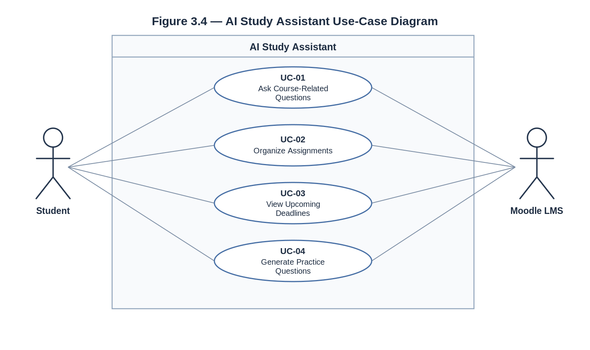

# 3 Specific Requirements

The requirements from the P1 baseline are retained and updated to reflect the team's selection of Moodle 5.3, the professor's feedback on QR-02, and the reconciliation of the use-case identifiers. Original requirement IDs have been preserved.

## 3.1 Functional Requirements

| ID | Requirement | Priority | Source | Acceptance Criterion |
|---|---|---|---|---|
| FR-01 | The system shall accept natural-language questions submitted by students. | MUST | Students | Submit 10 questions of varying lengths and verify that each is received completely without truncation. |
| FR-02 | The system shall retrieve course information from the connected LMS only for courses in which the verified student is enrolled. | MUST | Students | Compare retrieved course information against the enrolled student's accessible course records. |
| FR-03 | The system shall generate answers to student questions based only on retrieved course information. | MUST | Students | Submit at least 8 course-related questions and verify the answers against accessible course materials or confirm that insufficient information is reported. |
| FR-04 | The system shall retrieve the student's assignments and their submission status from each enrolled course. | MUST | Students | Compare retrieved assignments and submission statuses with the LMS records for the test student. |
| FR-05 | The system shall list assignments in ascending order of due date. | MUST | Students | Provide assignments with different due dates and verify chronological ordering. |
| FR-06 | The system shall identify assignments due within the next seven calendar days. | MUST | Students | Test assignments due inside and outside the seven-day period and verify that only those within the period are identified. |
| FR-07 | The system shall display an error message when requested LMS information cannot be retrieved. | MUST | Students | Simulate an LMS retrieval failure and verify that the student receives an understandable error message. |
| FR-08 | The system shall generate practice questions based on course materials. | SHOULD | Students | Select a course, request five practice questions, and verify that each relates to the selected course's material. |

The functional requirement IDs and priorities remain unchanged from P1.

## 3.2 Quality Requirements

| ID | Requirement | Priority | Source | Verification |
|---|---|---|---|---|
| QR-01 | The system shall respond to at least 95% of student queries within 5 seconds while supporting 20 concurrent users. | MUST | Students | Submit 100 queries with 20 concurrent simulated users and measure the response times. |
| QR-02 | The system shall enable at least 90% of first-time student users to locate their upcoming assignments within 60 seconds, without external assistance, during a usability test involving at least 10 students. | SHOULD | Students | Ask 10 first-time users to locate upcoming assignments. Measure completion time and verify that at least 9 complete the task within 60 seconds without assistance. |
| QR-03 | The system shall deny 100% of attempts by unauthenticated or unauthorized users to access protected course records, measured over at least 20 test attempts. | MUST | Students | Attempt unauthorized access using separate test accounts and verify that every request is denied. |
| QR-04 | The system shall achieve at least 95% factual accuracy on a predefined evaluation set of 100 questions answerable from accessible LMS course materials. | MUST | Students | Compare generated responses against an instructor-reviewed answer key and verify at least 95 correct responses. |

### QR-02 Correction

In P1, QR-02 did not clearly define when the student was expected to complete the assignment-finding task. The revised requirement defines:

- Task: Locate upcoming assignments.
- Population: First-time student users.
- Success threshold: At least 90%.
- Time limit: 60 seconds.
- Sample size: At least 10 students.
- Condition: No external assistance.

The requirement is now measurable and can be evaluated through a repeatable usability test.

## 3.3 Constraint Requirements

| ID | Constraint | Source | Rationale |
|---|---|---|---|
| CON-01 | The system shall integrate with the team's selected self-hosted Moodle 5.3 LMS for development and testing. | Project scope and team platform decision | Moodle provides the course-data access required by the prototype and fits the team's available development environment. |
| CON-02 | The system shall operate within the development environment and resource limits established for the CS 3354 course project. | Course project instructions and team resource agreement | The implementation must remain feasible within the team's resources and academic schedule. |

### Platform Change: Canvas to Moodle

The P1 proposal originally planned integration with Canvas. During development, the team found that its Canvas Lite environment did not provide the required API token access.

The team selected self-hosted Moodle 5.3 instead.

The current prototype demonstrates access to course information, assignments, announcements, and course pages using Moodle.

This change updates CON-01 without changing the project's central purpose: providing a read-only AI study assistant for students.

## 3.4 Initial Use Cases

The P1 feedback identified inconsistent use-case numbering between the diagram and traceability matrix.

The consolidated P2 use-case list is:

| Use Case | Name | Primary Actor | Related Requirements |
|---|---|---|---|
| UC-01 | Ask Course-Related Questions | Student | FR-01, FR-02, FR-03, FR-07 |
| UC-02 | Organize Assignments | Student | FR-02, FR-04, FR-05, FR-07 |
| UC-03 | View Upcoming Deadlines | Student | FR-02, FR-04, FR-06, FR-07 |
| UC-04 | Generate Practice Questions | Student | FR-02, FR-03, FR-08, FR-07 |

### Use-Case Numbering Reconciliation

*Figure 3.4. Student interactions with the AI Study Assistant and Moodle LMS.*

UC-01 and UC-02 retain their original identifiers and names.

UC-03 represents the student goal of identifying upcoming assignment deadlines within seven days.

UC-04 represents generating practice questions, consistent with the use-case diagram described in the P1 feedback.

The P1 traceability matrix incorrectly referenced UC-05 for practice-question generation. That reference is corrected to UC-04. No separate UC-05 actor goal was established in the P1 documentation.

The revised use-case model therefore uses UC-01 through UC-04 consistently.

### Scope and Implementation Status

UC-01 and UC-02 represent core system functions and are supported by the current prototype, although some specified behaviors remain incomplete.

Source references for UC-01, automated cross-course deadline organization, and practice-question generation are planned requirements rather than fully verified prototype features.

All four use cases describe the expected system behavior for subsequent development and evaluation.

Detailed analysis of selected use cases appears in Section 4.

## 3.5 Requirements Traceability

The extended requirements traceability matrix is maintained in Section 9.1 of the P2 document.

That matrix connects functional, quality, and constraint requirements to use cases, analysis classes, architectural components, and supporting design decisions.

The P1 traceability inconsistencies involving UC-03, UC-04, and UC-05 are resolved through the consolidated use-case list in Section 3.4.
