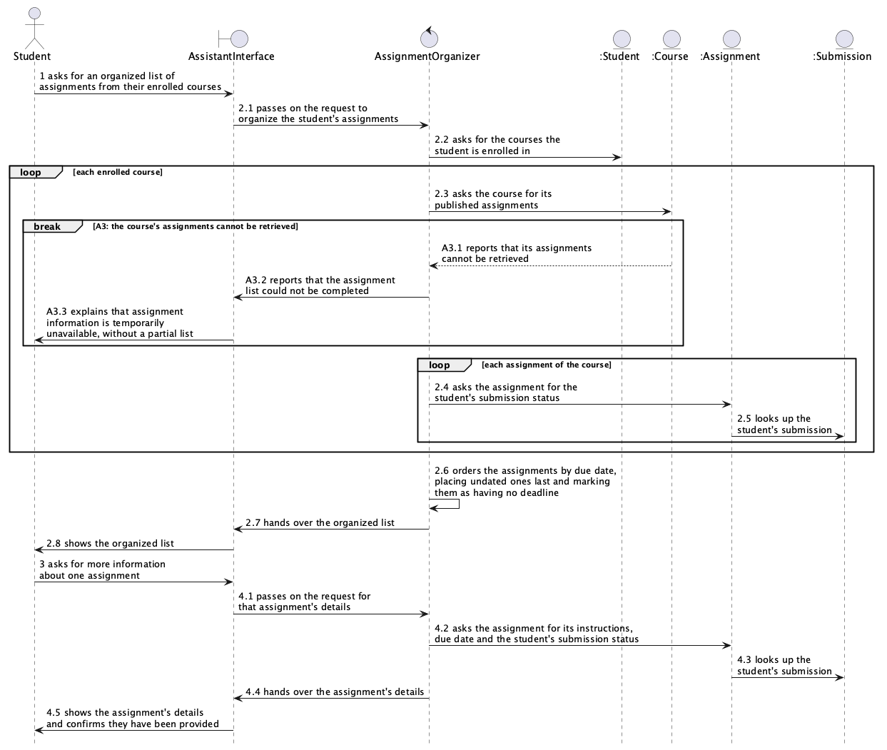

### 5.2.2 UC-02 Organize Assignments

**(a) Non-trivial steps.**

| Step (from 4.2) | Non-trivial? | Why |
|---|---|---|
| (0) The system presents the student's available courses | No | The same lookup of the student's courses appears as message 2.2, so it adds no new interaction |
| (1) The student requests an organized list of assignments | No | The student's input; the interface only receives it |
| (2) The system presents the assignments in ascending order of due date, with course names, due dates and submission statuses | Yes | Needs the student's enrolled courses, each course's assignments and the student's submission for each one, then an ordering that puts undated assignments last (A2) |
| (3) The student requests more information about one assignment | No | The student's input; the interface only receives it |
| (4) The system presents the assignment's instructions, due date and submission status | Yes | Needs the chosen assignment's details and the student's submission for it |
| A3 at step (2): assignment information cannot be retrieved | Yes | A course's records fail to arrive, and the student must be told without a partial list shown as complete |

Two interaction objects take part besides the domain classes from 5.1 (Student, Course, Assignment, Submission):

- **AssistantInterface** (boundary): takes the student's requests and shows the system's responses.
- **AssignmentOrganizer** (control): gathers the student's assignments across courses, puts them in order and fetches one assignment's details. It is in control of this interaction.

**(b) Scenario table.** Rows 2.3 to 2.5 repeat for each enrolled course and each of its assignments.

| Step | Subject (who acts) | Subject action (what it does) | Other data / objects (what is used) | Object acted upon (who receives) |
|---|---|---|---|---|
| 1 | Student | asks for an organized list of assignments from their enrolled courses | the request | AssistantInterface |
| 2.1 | AssistantInterface | passes on the request to organize the student's assignments | Student | AssignmentOrganizer |
| 2.2 | AssignmentOrganizer | asks for the courses the student is enrolled in | | Student |
| 2.3 | AssignmentOrganizer | asks the course for its published assignments | | Course |
| 2.4 | AssignmentOrganizer | asks the assignment for the student's submission status | Student | Assignment |
| 2.5 | Assignment | looks up the student's submission | Student | Submission |
| 2.6 | AssignmentOrganizer | orders the assignments by due date, placing undated ones last and marking them as having no deadline | due dates | AssignmentOrganizer |
| 2.7 | AssignmentOrganizer | hands over the organized list | each assignment's course name, due date and submission status | AssistantInterface |
| 2.8 | AssistantInterface | shows the organized list | the organized list | Student |
| 3 | Student | asks for more information about one assignment | the chosen assignment | AssistantInterface |
| 4.1 | AssistantInterface | passes on the request for that assignment's details | the chosen assignment | AssignmentOrganizer |
| 4.2 | AssignmentOrganizer | asks the assignment for its instructions, due date and the student's submission status | Student | Assignment |
| 4.3 | Assignment | looks up the student's submission | Student | Submission |
| 4.4 | AssignmentOrganizer | hands over the assignment's details | instructions, due date, submission status | AssistantInterface |
| 4.5 | AssistantInterface | shows the assignment's details and confirms they have been provided | the assignment's details | Student |
| A3.1 | Course | reports that its assignments cannot be retrieved | | AssignmentOrganizer |
| A3.2 | AssignmentOrganizer | reports that the assignment list could not be completed | the course's name | AssistantInterface |
| A3.3 | AssistantInterface | explains that assignment information is temporarily unavailable, without showing a partial list | | Student |

**(c) Analysis sequence diagram.**

*Figure 5.2.2 Analysis sequence diagram for UC-02; message numbers match the scenario table. Source: `docs/p2/diagrams/uc02-analysis-sequence.puml`.*

The last messages make the UC-02 postconditions true: 2.8 shows the available assignments in order of due date, 4.5 shows one assignment's details and confirms them, and on alternate flow A3, A3.3 gives the student the explanation.
