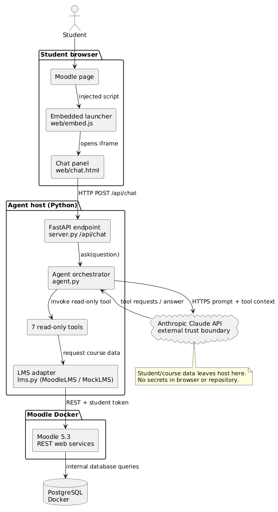
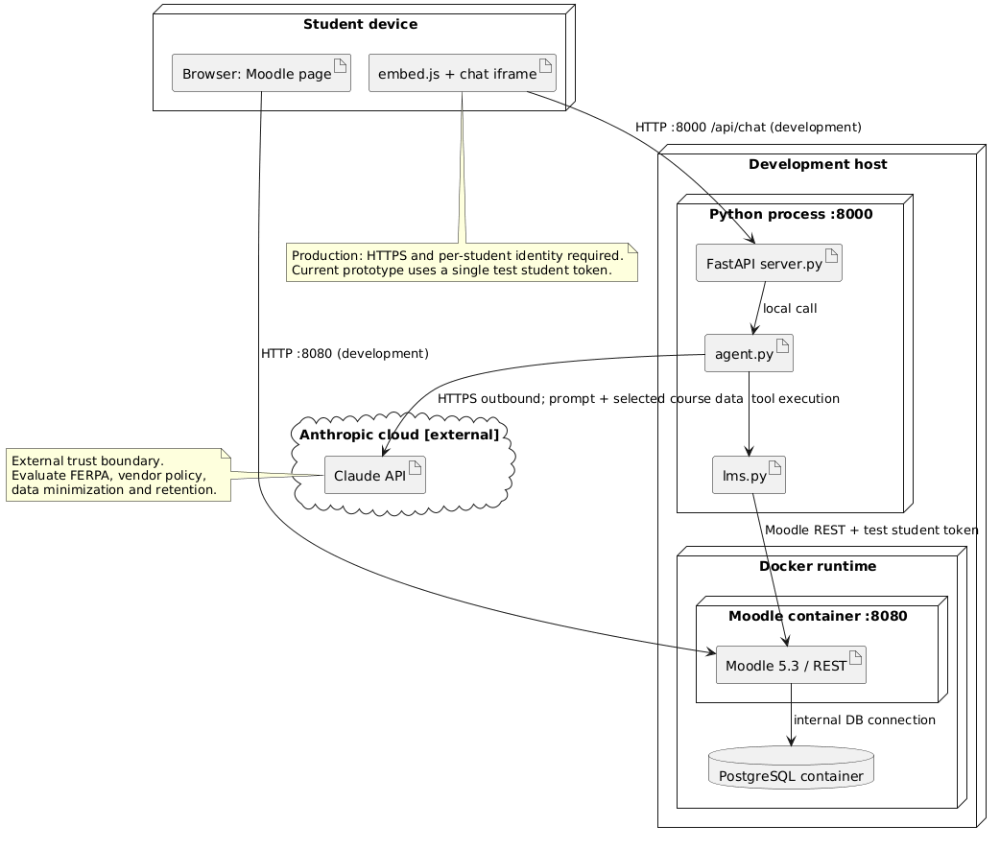

# 6. High-Level Design

## 6.1 Quality Attribute Scenarios

The following are verifiable design targets, not claims that the prototype has passed testing. The sources of these scenarios are the revised P2 requirements (Section 3) and the P3 development plan.

| Quality attribute | Artifact | Response | Response measure | From |
|---|---|---|---|---|
| **QAS-01: Performance (QR-01)**. Twenty students send ordinary course questions concurrently. | Chat panel, `POST /api/chat`, agent orchestrator, LMS adapter, Claude API | Accept concurrent questions and provide complete responses without blocking unrelated sessions. | **95 of 100 requests finish within 5.0 seconds**, measured from HTTP request start to full HTTP response, in batches of 20 concurrent requests; log p50, p95, error count and test configuration. This is a **target**, pending S-01 spike results. | QR-01; UC-01; spike S-01 |
| **QAS-02: Access control (QR-03)**. An unauthorized user requests another student's grades, or calls the endpoint without valid identity. | Chat API identity boundary, MoodleLMS adapter and Moodle access controls | Deny requests without verified identity or permission and disclose no protected records. | **20/20** negative authorization tests disclose **zero** protected records; reject invalid/missing credentials with HTTP 401/403 or equivalent. **Not met in the current prototype:** the API has no per-student authentication and uses one configured test token. | QR-03; FR-02; UC-01; ADR-05 |
| **QAS-03: Failure handling (FR-07)**. Moodle is unavailable or its REST API fails while a student asks about assignments. | LMS adapter, agent orchestrator, FastAPI and chat panel | Show a clear failure notice without fabricating assignment data or leaking credentials. | In **at least 19/20** simulated outages, show a non-sensitive error **within 10 seconds**; **0/20** label invented data as retrieved from Moodle. This is a proposed P3 test, not a measured result. | FR-07; UC-02; P3 backlog |

**Constraints shaping the architecture:** **CON-01** requires integration with the team's self-hosted Moodle 5.3 LMS, so academic data is retrieved through Moodle REST rather than Canvas. **CON-02** limits development to the course team's available resources, favoring a lightweight layered prototype and avoiding separately operated microservices. The existing Moodle-token design and external Claude dependency also require the security measures described in Section 6.4.

## 6.2 Architectural Style and Alternatives

**Selected architecture: layered client-server with an external AI service (ADR-01).** The presentation layer is the Moodle-embedded chat UI (`web/embed.js` and `web/chat.html`). The API/application layer is FastAPI (`server.py`) and the agent orchestrator (`agent.py`). The integration layer is the seven read-only tools plus `lms.py`. Moodle 5.3 and PostgreSQL maintain authoritative academic records; Anthropic Claude performs external AI inference. These are logical layers, not necessarily separate physical hosts.

| Style | Drivers it serves | What it costs | Verdict |
|---|---|---|---|
| **Layered client-server + external AI** | UC-01 through UC-04, QAS-01, separation of presentation/orchestration/LMS access, `MockLMS` testing, Moodle integration | Network round trips, latency and paid inference; external transfer of selected student context; single service failure point | **Selected**: simple fit for the actual Python/FastAPI prototype and ADR-01 |
| **Monolithic Moodle plugin** | Fewer independent endpoints; tight LMS UI integration | Couples model changes, secrets and deployment to Moodle plugin internals; harder independent offline testing | **Rejected**: unnecessary Moodle coupling |
| **Event-driven microservices with queues** | Can isolate components at larger scale and absorb asynchronous workloads | Multiple deployments, queue state, ordering, tracing and debugging for a small request/response prototype | **Rejected**: excessive complexity under CON-02 |

The chosen style allows the chat interface to change without rewriting Moodle access, isolates the real/mock LMS behind a consistent tool interface, and keeps LMS records in Moodle. It does **not** by itself meet the latency or authentication goals. In P3 the team plans per-student LTI 1.3 identity, source references, cross-course deadline logic and performance improvements.

## 6.3 Component View

*Figure 6.3. UML component view. Editable source: `docs/p2/diagrams/component-view.puml`.*

| Component | Responsibility | Provides | Requires | Answers to (UC / QAS / ADR) |
|---|---|---|---|---|
| Moodle embedded launcher (`web/embed.js`) | Make the assistant available inside Moodle pages | Button and embedded chat iframe | Moodle page, reachable chat host | UC-01, QR-02, ADR-04 |
| Chat panel (`web/chat.html`) | Capture requests and display answers or errors | Question input, answer display and status | FastAPI chat endpoint | UC-01–UC-04, QAS-03, ADR-04 |
| FastAPI (`server.py`) | Validate requests, manage temporary sessions, serve frontend and API | `POST /api/chat`, `/api/reset`, `/api/health` | Agent orchestrator, in-memory session state | UC-01–UC-04, QAS-01, QAS-02, ADR-01 |
| Agent orchestrator (`agent.py`) | Run Claude tool-calling loop and tutoring instructions | AI answer generation and tool selection | Claude API, seven LMS tools | UC-01–UC-04, QAS-01, ADR-01, ADR-03 |
| Seven read-only LMS tools (`agent.py`) | Expose course, assignment, page and announcement lookups | Typed retrieval operations | LMS adapter methods | UC-01–UC-03, ADR-03 |
| LMS adapter (`lms.py`) | Convert retrieval operations to Moodle REST or mock results | `MoodleLMS` / `MockLMS` interface | Moodle REST and configured test student token | UC-01–UC-03, QAS-02, ADR-02, ADR-05 |
| Moodle 5.3 REST service (external LMS subsystem) | Enforce LMS-side permissions and supply student-visible records | Moodle course-data REST API | PostgreSQL LMS database | UC-01–UC-03, ADR-02, ADR-05 |
| Anthropic Claude API (external provider) | Generate responses and tool requests | Model inference | Selected prompts, question/context | UC-01, UC-04, QAS-01, ADR-03 |

**Interaction flow:** student opens the embedded chat; the chat posts to `/api/chat`; FastAPI calls the agent; the agent sends a prompt/tool schema to Claude; the model requests a read-only tool when needed; the adapter fetches accessible Moodle data; the resulting tool content is passed back to Claude for an answer; FastAPI returns that answer to the panel. A question may cause multiple model and Moodle calls. The browser does not directly query PostgreSQL or call Claude.

**Known implementation gaps:** source citations, dedicated seven-day cross-course aggregation, measured response-time compliance, and per-student authentication are not yet implemented or verified.

## 6.4 Deployment View and Trust Boundaries

*Figure 6.4. UML deployment view. Editable source: `docs/p2/diagrams/deployment-view.puml`.*

| Node / boundary | Deployed elements | Communication and data |
|---|---|---|
| Student device/browser | Moodle web page, injected `embed.js`, iframe chat page | Browser loads Moodle over local HTTP port 8080 and chat/API over local HTTP port 8000 in the prototype. Production must use HTTPS and appropriate origin controls. |
| Local development host | Python FastAPI `server.py`, `agent.py`, `lms.py`; in-memory `sessions` and per-session locks | `/api/chat` invokes orchestration; LMS adapter calls Moodle REST. The server retains chat messages in RAM while running (up to 200 sessions, with eviction); it does **not** persist a conversation database. Current configuration uses one test student's token, **not** real per-user authentication. |
| Docker: Moodle container | Moodle 5.3, REST web services | Authoritative LMS authorization and course operations. |
| Docker: PostgreSQL container | Moodle database | Stores course, user, assignment, grade, page and announcement data; only Moodle should query it. |
| External Anthropic infrastructure | Claude model/API | Agent sends student prompts and selected course/tool context over HTTPS. **Data leaves the team's host and control at this boundary.** API credentials must remain server-side. |

**Security/privacy implications:** Sending identifiable course or grade information to Anthropic may involve education records; the team must evaluate institutional policy, FERPA applicability, vendor terms, retention, consent and minimization before using real student data. The chat API currently has **no per-student authentication check**, and a browser-supplied session ID refers to server-side chat history, not a verified student identity. All chat requests use the same configured Moodle token. Therefore the prototype is suitable for synthetic/test data, not proof of production FERPA compliance. LTI 1.3 student identity and authorization checks are planned for P3. No passwords, tokens or API keys belong in diagrams, repository commits or client JavaScript.

## 6.5 Analysis-to-Component Mapping

The table maps analysis objects (Section 5) to **components of this design**, not merely to the external record owner. Omor's UC-01 object names and final Section 5.1 model should be checked for exact spelling before the team assembles its PDF. "Split" means the analysis responsibility is implemented by more than one component; "external" means records are hosted by Moodle, not reimplemented in our agent.

| Analysis object / concept | Design component(s) from 6.3 | Allocation | Rationale |
|---|---|---|---|
| `AssistantInterface` (UC-02) | Moodle embedded launcher + chat panel (`web/embed.js`, `web/chat.html`) | Split | Opens the assistant, accepts student input and displays organized assignments. |
| `AssignmentOrganizer` (UC-02) | Agent orchestrator (`agent.py`) + read-only tools + LMS adapter (`lms.py`) | Split | Coordinates course/assignment requests; underlying data retrieval remains in the adapter. Chronological ordering and dedicated seven-day aggregation are not fully implemented. |
| Student | LMS adapter (`lms.py`) using Moodle user identity; FastAPI for temporary chat session | External record / split | Moodle owns student records; current prototype has only one configured test student token, not verified chat identity. |
| Course / Enrollment | LMS adapter (`lms.py`) via Moodle course retrieval | External record | Course/enrollment data resides in Moodle, exposed by the adapter. |
| Assignment / Submission | LMS adapter (`lms.py`) and read-only assignment tools | External record | Moodle supplies deadlines, statuses and assignment instructions. |
| Grade | LMS adapter (`lms.py`) and course/assignment tools | External record | Grades remain authoritative in the Moodle gradebook. |
| Announcement | LMS adapter (`lms.py`) and announcement tool | External record | Moodle forum/announcement records are accessed read-only. |
| Course module / Page / Syllabus | LMS adapter (`lms.py`) and module/page/syllabus tools | External record | The adapter normalizes course content for use in answers. |
| Student question / Chat session | Chat panel + FastAPI in-memory session dictionary | Split | Browser submits question; server retains temporary history, not a persistent database. |
| Generated answer / tool request | Agent orchestrator + external Claude API | Split / external service | Claude generates responses/tool requests; the agent validates and executes defined LMS tools. |

## 6.6 Design Principles

| Principle | Design evidence | Benefit / trade-off |
|---|---|---|
| **Separation of concerns** | `web/chat.html` and `web/embed.js` own user interaction; `server.py` owns HTTP endpoints/session handling; `agent.py` owns model workflow; `lms.py` owns Moodle access. | Changes remain localized; additional layer boundaries require clear interfaces. |
| **Information hiding** | Moodle tokens and REST request parameters are encapsulated in `MoodleLMS`; the chat UI calls `/api/chat` rather than handling Moodle credentials. | The client cannot directly read tokens; backend must still authenticate users before real deployment. |
| **Low coupling** | `agent.py` calls the same seven methods whether `make_lms()` returns `MoodleLMS` or `MockLMS`; the browser speaks only to the FastAPI contract. | Supports offline tests and possible future LMS adapters; actual adapter remains Moodle-specific. |
| **High cohesion** | The agent manages inference/tool choices; the LMS adapter performs data retrieval; chat files manage presentation; Moodle maintains its academic database. | Each module has a focused responsibility, making failures easier to locate. |
| **Design for change** | `MockLMS` and `MoodleLMS` share a tool interface; P3 additions (LTI identity, citations, 7-day aggregation) can be introduced without replacing the UI and database. | Identity and citation contracts still need explicit implementation and testing. |
| **KISS (Keep It Simple)** | One FastAPI service, an embedded browser panel, seven read-only retrieval tools, Moodle containers and one external model; rejected queued microservices and a custom Moodle plugin. | Less operational complexity, but sequential external calls may affect QAS-01 latency. |

